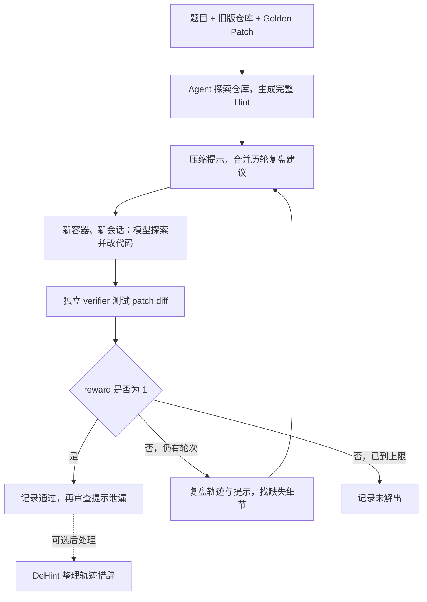

# 这个实验具体做了什么

可以把它理解成“给程序员一份解题指导，再让他自己改代码”。题目是一个真实仓库中的功能需求或 bug。模型要阅读仓库、执行命令、修改文件，最后交出一份代码补丁。独立的测试环境检查补丁是否让任务通过。

实验多加了一位“看过参考答案的辅导员”：它根据 Golden Patch 和仓库生成指导。第一次没做对，就看解题过程，指出遗漏的关键点，更新指导，再开一轮。模型服务是可配置的，执行框架使用 Claude Code Agent SDK；使用这个 SDK 不意味着一定调用 Claude 模型。

## 输入和输出

| 输入 | 用途 | 从哪里来 |
|---|---|---|
| `instance_id`、`problem_statement` | 定位题目，告诉模型要实现什么 | Parquet 任务行 |
| `base_commit` | 把仓库恢复到题目开始时的版本 | Parquet |
| `image_name` | 启动包含任务仓库及环境的容器 | Parquet 指向的镜像 |
| `installation_command`、`git_scrub_command` 等 | 安装项目依赖，按任务约定整理环境 | Parquet，可选 |
| Golden Diff / Golden Patch | 告诉提示生成者正确修复涉及什么 | 显式补丁文件、`solution.patch` 或 Parquet 的 `patch` |
| `tasks/<id>/tests/` 和 `task.toml` | 构建独立验收环境，运行测试 | DeepSWE 任务目录 |
| 模型名称、端点、Key、超时等 | 让生成、解题、复盘阶段能调用模型 | 运行者配置 |

| 输出 | 表示什么 |
|---|---|
| `hint_output.md` | 在仓库中探索后生成的完整指导 |
| `hint_compact_rN.md` | 第 N 轮实际给解题 Agent 的压缩提示 |
| `patch.diff` | 模型这轮对仓库的修改，是任务的核心交付 |
| `trajs.json` 和日志 | 模型说了什么、用了哪些工具、做了哪些修改 |
| `system_prompt_config.json` / `system_prompt_actual.json` | 配置了什么系统提示、代理实际收到什么提示 |
| `eval_result.json` | 测试成绩、reward、通过/失败信息 |
| `review_hint_traj.json` / `.md` | 是否用好提示、有没有泄漏提示、失败在哪里、下轮补充什么 |
| `loop_summary_<id>.json` | 尝试了几轮、哪轮通过、各轮产物路径 |
| `dehint/` 下的文件 | 可选的轨迹措辞整理结果与泄漏检查报告 |

## 主流程

### 1. 先做完整 Hint

[get_hint_by_task.py](../source/benchmark/deepswe/get_hint_by_task.py) 找到任务行，启动容器，把仓库恢复到 `base_commit`。它把题目和 Golden Diff 放进提示生成环境，让 Agent 用搜索、读文件、终端等工具探索仓库，输出问题本质、关键位置、解决步骤和易错点。

Golden Diff 的优先级是：有效的显式 `--golden_diff_file` → `tasks/<id>/solution/solution.patch` → Parquet 的 `patch`。当前代码的提示词要求生成者不要修改源代码，代码没有自动把 Golden Patch 应用到仓库。此前 Markdown 中“拿着 golden patch 真正 apply 一次”是对思路的通俗描述，不能据此认为脚本已自动应用答案。

### 2. 把完整指导压缩为系统提示

[compress_hint.py](../source/benchmark/deepswe/compress_hint.py) 让模型提取“问题分析、建议方向、关键位置线索”，删去代码块、精确行号和过细的实现步骤。通常不超过 500 个英文词是提示词要求，并没有硬截断器。

脚本再拼上固定的使用规范：先探索并核实文件线索，再使用相应信息；轨迹中不要直接写“hint says”。失败后，上一轮及更早的 `corrective_hint` 会一起参与下次压缩，补入关键警告。完整 Hint 的参考答案信息会间接影响解题，因此“先探索”不等于解题模型没有参考答案辅助。

### 3. 让模型真正改代码

[run_loop_by_hint.py](../source/benchmark/deepswe/run_loop_by_hint.py) 调用 [run_one_loop.sh](../source/benchmark/deepswe/run_one_loop.sh)，后者启动 [run_multi_turn_loop.py](../source/run_multi_turn_loop.py)。压缩 Hint 经 `APPEND_SYSTEM_PROMPT_FILE` 进入 [run_cc_sdk.py](../source/run_cc_sdk.py)，被包在 `<system-reminder>` 中，追加到 Claude Code 的预设系统提示。

模型拿到题目和这份提示，自己读代码、调用工具、改文件，最后导出 `patch.diff`。压缩 Hint 是解题阶段的直接输入；完整 Golden Diff 由提示生成和复盘阶段读取。任务包和镜像本身是否还暴露答案，应另查原有隔离记录。

**这里的“多轮”有两种含义。** 外层是最多 5 次 Hint 尝试；每次调用底层 runner 都指定 `max_turns=1`。这不代表模型只调用一次工具，而是底层只完成一次“解题→验收”周期。下一次外层尝试会新建容器、恢复旧版仓库、开新会话；只带上更新的 Hint，不带上一轮补丁。底层 runner 自身具备会话 resume 能力，但此实验的外层没有开启它。

### 4. 用测试验收补丁

[eval_deep_swe.py](../source/benchmark/deepswe/eval_deep_swe.py) 根据任务 `tests/Dockerfile` 构建 verifier，在独立容器中把模型补丁放到 `/logs/artifacts/model.patch`，执行 `/tests/test.sh`，读取 reward 文件。`reward == 1` 表示通过。

模型补丁不需要和 Golden Diff 一字不差，只要通过任务的验收条件。`FAIL_TO_PASS` 表示修复前失败、修复后应通过的测试；表格中的 F2P 是这一部分的通过数量。判断整题是否通过以 reward 为准，不能仅凭补丁看起来合理或模型自述完成。

### 5. 没通过，就复盘提示与轨迹

[review_hint_traj.py](../source/benchmark/deepswe/review_hint_traj.py) 读取本轮轨迹、实际用过的 Hint、Golden Diff，判断模型有没有采用指导，是否暴露指导来源，关键错误是什么，以及更像提示缺失还是模型执行能力不足。生成的 `corrective_hint` 会参与下一轮压缩。

复盘脚本没有直接接收 `eval_result.json`；测试结果若未出现在轨迹里，就不能认为复盘模型看到了完整验收信息。工具输出默认仅保留首尾各 500 字符供复盘阅读，也可能丢失中间内容。成功轮仍做泄漏审查，审查失败只记警告，不取消 solved 成绩。最后一轮失败后不会再生成用于下一轮的复盘。

### 6. 可选 DeHint

[update_trajs.py](../source/update_trajs.py) 从已经生成的轨迹中提取文本和 thinking，分批让模型提出 old→new 的精确文本替换，清理直接引用提示或评测背景的措辞，并输出整理报告。它通过单独脚本调用，不是主循环自动必经的步骤。

例如把“根据 Hint，应当修改解析器”改成“需要修改解析器”。它改的是记录表述，原先的工具动作、补丁和成绩已经发生。处理后的记录不能作为模型独立推导的证明；分析实验时应同时保留处理前轨迹和改动报告。

## 实际测试了什么

核心观测是“参考答案生成的指导 + 复盘 + 重试，能否帮助 Agent 把代码任务做对”。此外还观察模型是否遵守提示使用规范、推理中是否出现难以解释的跳步，以及轨迹是否明显透露提示存在。

它不是一次新的模型训练，也没有证明无提示的通用编程能力提高。要拆分提示本身的作用，需要额外对照：同模型、同任务、同超时和相同重试预算，比较无提示重试、固定 Hint 重试、Hint 复盘重试，并统计所有轮次及提示生成成本。现有 10 题报告未提供完整这些对照，详见 [结果说明](../results/README.md)。
