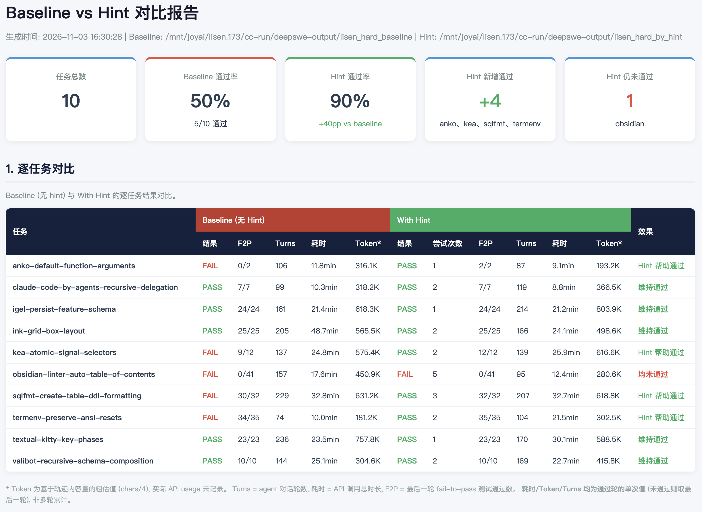

# 历史实验结果与口径

这里是此前实验 Markdown 配图中报告的转录，报告时间为 **2026-11-03 16:30:28**。本次整理没有重新运行实验，也没有拿到完整逐次原始轨迹、补丁和验收日志。

## 主要结果

| 条件 | 通过数 | 通过率 |
|---|---:|---:|
| 无 Hint baseline | 5/10 | 50% |
| Hint 生成 + 复盘 + 最多 5 轮重试 | 9/10 | 90% |

增加 **40 个百分点**。Hint 首轮通过 3 道；累计到第 2 轮通过 8 道，第 3 轮通过 9 道。Obsidian 题尝试 5 轮仍失败。

## 逐题结果

| 任务 | Baseline | F2P | Hint | 尝试次数 | F2P |
|---|---|---:|---|---:|---:|
| anko-default-function-arguments | FAIL | 0/2 | PASS | 1 | 2/2 |
| claude-code-by-agents-recursive-delegation | PASS | 7/7 | PASS | 2 | 7/7 |
| igel-persist-feature-schema | PASS | 24/24 | PASS | 1 | 24/24 |
| ink-grid-box-layout | PASS | 25/25 | PASS | 2 | 25/25 |
| kea-atomic-signal-selectors | FAIL | 9/12 | PASS | 2 | 12/12 |
| obsidian-linter-auto-table-of-contents | FAIL | 0/41 | FAIL | 5 | 0/41 |
| sqlfmt-create-table-ddl-formatting | FAIL | 30/32 | PASS | 3 | 32/32 |
| termenv-preserve-ansi-resets | FAIL | 34/35 | PASS | 2 | 35/35 |
| textual-kitty-key-phases | PASS | 23/23 | PASS | 1 | 23/23 |
| valibot-recursive-schema-composition | PASS | 10/10 | PASS | 2 | 10/10 |

完整 Turns、耗时和估算 Token 数保存在 [JSON](reported_results.json) 和 [CSV](reported_results.csv)。CSV 用 UTF-8 BOM 便于常见表格工具读取；[任务 ID 列表](task_ids.txt) 可用于选择相同题目。

## 指标怎么读

- **PASS/FAIL**：整题是否通过，以测试 reward 为准。
- **F2P**：Fail-to-Pass 测试通过数/总数。部分通过不一定算整题 solved，还需满足完整验收规则。
- **Hint 尝试次数**：外层尝试轮数，通过题对应成功的轮次，失败题对应已尝试轮数。
- **Turns**：SDK 轨迹中的交互统计，不等于 Hint 外层尝试次数。
- **Token (K)**：根据轨迹字符数除以 4 粗估的千 Token；不是模型服务的精确账单。
- **耗时、Token、Turns 的范围**：取成功轮，或始终失败题的最后轮；不是所有失败轮次的累计，也未包含完整 Hint 生成、压缩和复盘成本。

因此，看到某题 Hint 成功轮更快或更省 Token，不能直接得出整个 Hint 实验更省钱的结论。

## 能得出什么、还缺什么

这 10 道题表明参考答案指导和反馈重试流程能帮助更多任务通过测试。不能把 90% 当作一次 Hint 的通过率，也不能当作 DeepSWE 全部 113 题的成绩。

此前 Markdown 说 baseline 已多次 rollout 排除偶现，但没有给出每次运行记录；当前代码的 `--no_hint_run` 每次调用只跑一轮。对比不具备完整相同重试预算的证据，无法把增益单独归因于提示内容。

历史报告没有明确模型、模型版本、数据版本和完整依赖环境。包中保留的源码提交时间晚于截图报告时间，源码默认值不能反推历史运行条件。要严格复现，需补齐这些信息和原始运行目录。

原 Markdown 报告 **8/10 会泄漏 Hint 相关内容**，没有提供 DeHint 后完整统计。DeHint 是轨迹措辞后处理，不改变测试成绩，不能据处理后的文字声称模型从未使用提示。

如果继续做实验，建议分别报告无提示重试、固定 Hint 重试、Hint 复盘重试，在相同模型、任务和总预算下比较，并累计全部失败轮、提示生成/压缩/复盘的成本。
