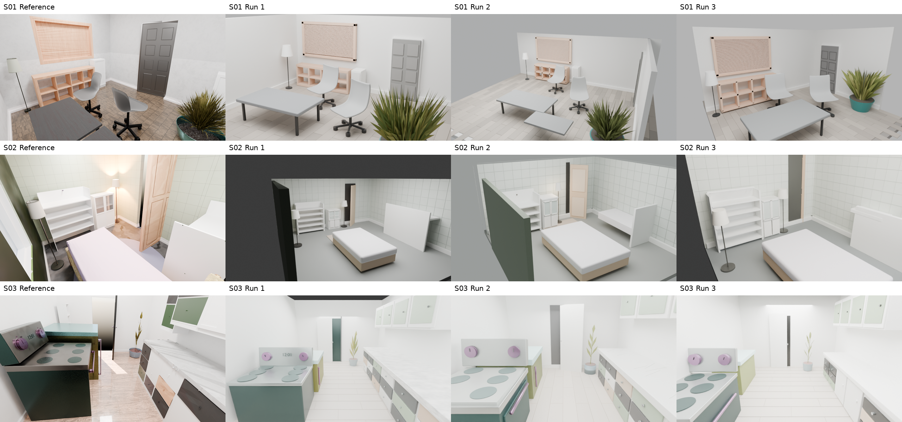

# Scene RSI：自然重建轨迹实验 01

这是独立的图像到可编辑 Blender 场景实验。学生沿用 hintrsi 的 Claude Agent SDK 执行循环，Codex CLI Bridge 仅调用 `gpt-6.1-terra`（low）返回模型决策，工具由 SDK 执行。本次没有教师、Hint、Skill、持久知识或旧 Memory，也没有进行完整 RSI。

- `sdk/`：复用 trajectory-to-capability 的 SDK、Bridge、消息转换与日志代码；多模态改动见实验目录的 `sdk_changes.diff`。
- `harness/`：新建的文件与网络隔离、SDK 入口、透明 Blender 记录器及两路调度。没有 SceneEvolve 建模策略。
- `configs/`：统一英文提示词、冻结场景清单与资源配置。
- `data/`：IDEAL-Scenes 的少量候选资料，以及只对评价端开放的三个完整 GT。
- `analysis/`：实验结束后的场景提取、复现、轨迹比较和人工评价材料生成。
- `experiments/experiment_01_natural_trajectories/`：真实预检、工程中断、九次正式执行及报告。

正式场景为办公室、卧室、厨房，各独立重建三次。学生只能访问匿名 RGB 图片；GT、其他结果、已有 Scene 工程与互联网均不在学生可访问范围内。每次预算为 25 分钟、120 次模型请求、8 个 CPU 核，要求 640×360 最终渲染。

实验协议见 `experiments/experiment_01_natural_trajectories/PROTOCOL.md`，实际工程问题见 `ENGINEERING_LOG.md`，完成后研究报告保存在同一目录。SDK 自报的美元费用不是 Codex 实际账单；实际记录请求数、Token 和耗时。

数据来源：[IDEAL-Scenes](https://huggingface.co/datasets/IDEAL-Benchmark/IDEAL-Scenes)，CC BY 4.0。[项目主页](https://ideal3d.github.io/)。仅复用数据，没有复用其 Agent 或重建 Harness。

已完成：九次正式重建、九次独立再生成与事后分析。详见 [中文研究报告](experiments/experiment_01_natural_trajectories/REPORT_ZH.md) 和 [人工评价页面](experiments/experiment_01_natural_trajectories/analysis/human_review/index.html)。正式源码快照在 source_at_formal_run；当前 Bridge 还包含全部运行结束后修复的后端超时回收，未与正式结果混用。

## GitHub 文件说明

本仓库包含九次正式实验、预检及中断记录的源码、配置、原始模型与工具轨迹、学生代码、可编辑 Blender 场景、渲染、独立复现和事后分析。三个完整 GT 也包含在仓库内，数据遵循 IDEAL-Scenes 的 CC BY 4.0 许可。没有使用 Git LFS，直接克隆即可取得这些文件。

为避免上游数据集的 Git LFS 设置影响本仓库，原始 `data/.gitattributes` 原文保存为 [upstream_dataset.gitattributes.txt](data/upstream_dataset.gitattributes.txt)。实验完成时生成的 `file_index.json` 和 `sync_manifest.json` 作为历史记录保留；本次上传范围见 [publication.json](publication.json)。运行环境、依赖二进制、登录凭据、临时 home 和缓存未上传。配置中的本机环境路径需要在其他服务器上调整，依赖环境并未打包。

- [完整中文报告](experiments/experiment_01_natural_trajectories/REPORT_ZH.md)
- [重复缺陷与互补策略案例](experiments/experiment_01_natural_trajectories/analysis/CASES_ZH.md)
- [配对策略相似度](experiments/experiment_01_natural_trajectories/analysis/pairwise_metrics.csv)
- [消耗统计](experiments/experiment_01_natural_trajectories/analysis/usage_summary.json)
- [正式执行时的源码与配置](experiments/experiment_01_natural_trajectories/source_at_formal_run)
- [九次运行的完整文件](experiments/experiment_01_natural_trajectories/runs)
- [人工评价页面](experiments/experiment_01_natural_trajectories/analysis/human_review/index.html)：下载仓库后用浏览器打开；未填入任何人工评分。

