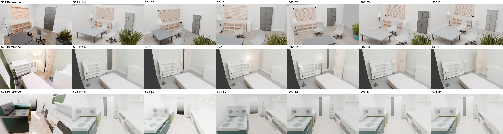
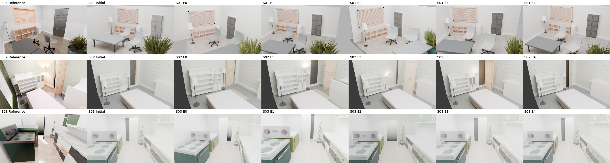

# Scene RSI Experiment 02：教师引导的能力诊断与主动探索

报告生成：2026-11-28 03:06:55（北京时间）。

本批实际保存 30 次共同检查点分支运行：核心 15 次与额外完整重复分开记录。30 次通过独立执行交付代码及随附资源、生成标准场景/图像并打开原始场景的技术检查，其中 30 次独立再生成图像与交付图逐像素一致。技术完成度不等于目标缺陷解决或视觉恢复成功。

这不是完整 RSI、长期能力学习、教师自演化、Harness Evolution 或模型微调。本次固定教师没有经过真实人工审美对齐，人工评分全部为空。

最直接的结果是：具体指导能够改变本次任务中的建模与验证行为，效果依赖案例，没有呈现 E0→E4 单调改善。下表保留核心 R1 与额外重复 R2 的实际差异；支撑间隙、房门掩码和自动视觉判断是不同证据，不能相加为总分。

| 组别 | 两椅支撑间隙（Blender 单位） | 房门参考视角 IoU | 厨房目标盲评 |
| --- | --- | --- | --- |
| E0 | R1: 0.015, 0.015；R2: 0.015, 0.015 | R1: 0.000；R2: 0.237 | R1: partial/unchanged；R2: partial/unchanged |
| E1 | R1: 0.015, 0.015；R2: 0.015, 0.015 | R1: 0.000；R2: 0.177 | R1: unresolved/unchanged；R2: unresolved/unchanged |
| E2 | R1: 两椅均在容差内；R2: 0.080, 0.080 | R1: 0.592；R2: 0.767 | R1: partial/improved；R2: unresolved/worse |
| E3 | R1: 两椅均在容差内；R2: 两椅均在容差内 | R1: 0.051；R2: 0.125 | R1: partial/improved；R2: partial/improved |
| E4 | R1: 两椅均在容差内；R2: 两椅均在容差内 | R1: 0.573；R2: 0.000 | R1: partial/improved；R2: partial/improved |

椅子近零间隙不等于证明完整机械连接；门板 IoU 高也可能伴随不合理的门轴/墙体关系。具体方法、反例和十个研究问题见第 5 节。

## 1. 研究设计与实际复用

沿用 Experiment 01 的 Claude Agent SDK 执行循环、Codex CLI Bridge、多模态传递、Blender 执行、文件/网络隔离与被动记录。没有使用 Codex 原生 Agent 执行学生的文件工具，也没有继承 SceneEvolve 的重建策略。CLI 是底层模型决策后端，实际 Bash/Read/Write/Edit 及其结果由 SDK 维护。

每组从同一份代码、scene.blend、final.png、参考图和相关资源独立复制。所有会话全新，未恢复原学生对话，因此准确称为“共同场景检查点分支实验”。学生不知道其他组的执行结果，教师和学生都没有 GT 挂载或网络搜索权限；GT 只用于所有学生结束后的评价。

模型统一为 gpt-6.1-terra / low，实际 CLI 参数经过逐请求审计。运行版本：codex-cli 0.163.0、Claude Agent SDK 0.2.186、Blender 5.2.2。请求接受与记录的标识不能独立证明服务商内部权重版本。

| 案例 | 初始运行 | 本批共同目标 |
| --- | --- | --- |
| S01 | S01-R1 | 两把办公室椅子的支撑、轮子及底座关系 |
| S02 | S02-R3 | 卧室门板朝向、投影及前景遮挡 |
| S03 | S03-R2 | 厨房右台面的材质与纹理外观 |

初始检查点来自 Experiment 01，原结果未修改。本批源代码和固定输入分别见 source_at_formal_run、source_at_repeat_start、checkpoints 与 configs/cases.json；新增代码及真实修复另行保存。

## 2. 组别、Prompt、预算与冻结顺序

| 组别 | 实际追加指导 |
| --- | --- |
| E0 | 无额外指导，继续自主改善当前重建 |
| E1 | 通用比较、自检和修复要求，不指明错误物体或技术 |
| E2 | 教师给出的具体缺陷，不提供修复方法 |
| E3 | 与 E2 完全相同的缺陷文字，加一种策略和验证方向 |
| E4 | 与 E2 完全相同的缺陷文字，加至少两种不同假设或方法及比较要求 |

完整英文任务与实际指导保存在 prompts/ 和 hints/。Hint 位于初始用户消息的 Additional guidance 部分；SDK 系统提示保持相同。教师先读取参考图、当前渲染、代码、保存状态、原始轨迹和既有客观证据，再生成诊断与全部指导；未读取 GT .blend、精确坐标或隐藏结构。教师工作区的原始代码/场景/渲染均未被改动。

所有学生同为 1500 秒追加执行、最多 120 次进入 Bridge 的模型请求、120 SDK turn 上限、8 核 CPU、nice 15、每进程 32 GiB 地址空间上限，最终渲染 640×360。两路分别使用 32–39、40–47。允许自主提前结束；相同上限不等于实际消耗相同。没有设置可核验的模型采样 seed，也没有跨会话 Memory、Skill、持久知识或在线教师。

实际每次学生使用 4–21 次 Bridge 请求、66.0–491.8 秒 SDK 墙钟，30 次均以 sdk_exit 正常结束，没有触发时间或调用上限。残留缺陷发生在预算尚未耗尽时；这支持分析自主停止与复核行为，但不能推断强制执行更久就一定能够修复。

核心顺序在正式执行前冻结并交错场景。额外重复严格依据预先记录的时间条件启动，顺序反转，仍从原检查点开始；没有依据评价结果追加某个组。没有运行第二初始检查点或 E5。

各场景 E0–E4 的指导字数分别为：

| 场景 | E0 | E1 | E2 | E3 | E4 |
| --- | --- | --- | --- | --- | --- |
| S01 | 0 | 28 | 14 | 68 | 93 |
| S02 | 0 | 28 | 30 | 89 | 136 |
| S03 | 0 | 28 | 25 | 87 | 109 |

提示长度与具体内容共同变化，不能把本批差异单独归因于“探索”二字或纯知识量。教师准备成本单列，没有假装为零。

## 3. 独立评价及证据边界

继续使用 Experiment 01 已冻结、已验证的 IDEAL-Scenes 数据，不重新下载或挑选样本。来源与许可沿用其数据清单：

| 匿名案例 | 原数据场景 | 记录许可 | 原始来源 |
| --- | --- | --- | --- |
| S01 | office_s1210607561 | CC-BY-4.0 | [数据目录](https://huggingface.co/datasets/IDEAL-Benchmark/IDEAL-Scenes/tree/main/office/office_s1210607561) |
| S02 | bedroom_s1379154150 | CC-BY-4.0 | [数据目录](https://huggingface.co/datasets/IDEAL-Benchmark/IDEAL-Scenes/tree/main/bedroom/bedroom_s1379154150) |
| S03 | kitchen_s1075679984 | CC-BY-4.0 | [数据目录](https://huggingface.co/datasets/IDEAL-Benchmark/IDEAL-Scenes/tree/main/kitchen/kitchen_s1075679984) |

GT 的完整本地位置见 ../../configs/scenes.json 与本批 file_index.json 的 reused_ground_truth；原始 GT 保存在独立 data/evaluation_gt，学生和教师都只获得原参考 RGB 与学生检查点资料。

所有学生执行结束后，评价端才打开交付文件、独立再生成、提取真实检查点状态并执行几何/图像评价。视觉评价使用匿名随机编号，只看参考图、初始图与单个候选图，不看组别、Hint 或其他候选。视觉评价与轨迹标注都通过同一 SDK/Bridge/模型执行，属于自动评价，不能冒充人工评分。

实际得到 30 份有效视觉评价、30 份有效轨迹标注；对应正常结束的评价会话分别为 30、30。原始模型输出、重试与缺失用量均保留。

椅子使用实际评估后的世界空间网格，分开识别两把完整组件和局部地板。误差容忍 1e-4 个学生 Blender 单位；正间隙证明分离，近零或包围盒重叠不证明完整物理接触，穿入和组件连接另列。门记录可见/完整投影、门轴和框体；只有语义对应可靠时才计算 GT 辅助重叠。厨房保留初始相机、灯光、World 和显示参数下的辅助图，候选几何仍可能混杂材质判断。SSIM 仅为像素辅助指标。

Blender 原始退出码为 0 不一定意味着 Python 没有异常；学生原始日志和异常都保留，独立再生成统一使用 Python 异常退出设置，并核对真实产物。评价端测量不被计为学生实际做过的检查。

## 4. 每次运行的实际结果

### 核心批次

| 运行 | SDK 状态 | Bridge 请求 | SDK 分钟 | Blender 日志异常 | SDK 工具错误 | 代码修改 | 自动目标判定 | 自动目标变化 | 自动整体变化 | 辅助 SSIM 初始→最终 |
| --- | --- | --- | --- | --- | --- | --- | --- | --- | --- | --- |
| S01-E0-R1 | completed | 14 | 5.38 | 0 | 0 | 是 | unknown | unknown | mixed | 0.525 → 0.557 |
| S01-E1-R1 | completed | 21 | 8.20 | 0 | 0 | 是 | unknown | unknown | mixed | 0.525 → 0.569 |
| S01-E2-R1 | completed | 8 | 3.71 | 0 | 0 | 是 | unknown | unknown | mixed | 0.525 → 0.553 |
| S01-E3-R1 | completed | 8 | 2.73 | 0 | 0 | 是 | unknown | unknown | mixed | 0.525 → 0.509 |
| S01-E4-R1 | completed | 7 | 2.62 | 0 | 0 | 是 | unknown | unknown | mixed | 0.525 → 0.523 |
| S02-E0-R1 | completed | 7 | 2.32 | 0 | 0 | 是 | partial | improved | improved | 0.673 → 0.669 |
| S02-E1-R1 | completed | 13 | 4.73 | 0 | 0 | 是 | partial | improved | improved | 0.673 → 0.696 |
| S02-E2-R1 | completed | 16 | 5.35 | 0 | 0 | 是 | partial | improved | improved | 0.673 → 0.671 |
| S02-E3-R1 | completed | 11 | 3.42 | 0 | 0 | 是 | partial | improved | improved | 0.673 → 0.676 |
| S02-E4-R1 | completed | 19 | 6.96 | 0 | 0 | 是 | partial | improved | improved | 0.673 → 0.681 |
| S03-E0-R1 | completed | 9 | 3.13 | 0 | 0 | 是 | partial | unchanged | mixed | 0.595 → 0.589 |
| S03-E1-R1 | completed | 9 | 3.81 | 0 | 0 | 是 | unresolved | unchanged | mixed | 0.595 → 0.590 |
| S03-E2-R1 | completed | 7 | 2.78 | 0 | 1 | 是 | partial | improved | improved | 0.595 → 0.590 |
| S03-E3-R1 | completed | 4 | 1.10 | 0 | 0 | 是 | partial | improved | improved | 0.595 → 0.595 |
| S03-E4-R1 | completed | 8 | 3.19 | 2 | 0 | 是 | partial | improved | improved | 0.595 → 0.595 |

### 额外完整重复

| 运行 | SDK 状态 | Bridge 请求 | SDK 分钟 | Blender 日志异常 | SDK 工具错误 | 代码修改 | 自动目标判定 | 自动目标变化 | 自动整体变化 | 辅助 SSIM 初始→最终 |
| --- | --- | --- | --- | --- | --- | --- | --- | --- | --- | --- |
| S01-E0-R2 | completed | 12 | 5.23 | 0 | 0 | 是 | unknown | unknown | mixed | 0.525 → 0.592 |
| S01-E1-R2 | completed | 10 | 4.54 | 0 | 1 | 是 | unknown | unknown | mixed | 0.525 → 0.558 |
| S01-E2-R2 | completed | 14 | 5.40 | 0 | 0 | 是 | partial | unknown | mixed | 0.525 → 0.553 |
| S01-E3-R2 | completed | 8 | 3.14 | 0 | 0 | 是 | partial | unknown | mixed | 0.525 → 0.586 |
| S01-E4-R2 | completed | 10 | 4.24 | 0 | 0 | 是 | unknown | unknown | mixed | 0.525 → 0.543 |
| S02-E0-R2 | completed | 7 | 3.02 | 0 | 0 | 是 | partial | improved | mixed | 0.673 → 0.653 |
| S02-E1-R2 | completed | 15 | 4.98 | 0 | 0 | 是 | partial | improved | mixed | 0.673 → 0.661 |
| S02-E2-R2 | completed | 13 | 5.29 | 0 | 0 | 是 | partial | improved | improved | 0.673 → 0.676 |
| S02-E3-R2 | completed | 19 | 6.25 | 0 | 0 | 是 | partial | improved | improved | 0.673 → 0.666 |
| S02-E4-R2 | completed | 12 | 5.50 | 0 | 0 | 是 | partial | improved | improved | 0.673 → 0.670 |
| S03-E0-R2 | completed | 8 | 3.42 | 0 | 0 | 是 | partial | unchanged | mixed | 0.595 → 0.603 |
| S03-E1-R2 | completed | 6 | 2.35 | 0 | 0 | 是 | unresolved | unchanged | mixed | 0.595 → 0.583 |
| S03-E2-R2 | completed | 7 | 2.84 | 0 | 0 | 是 | unresolved | worse | mixed | 0.595 → 0.594 |
| S03-E3-R2 | completed | 8 | 2.43 | 0 | 5 | 是 | partial | improved | improved | 0.595 → 0.595 |
| S03-E4-R2 | completed | 7 | 3.60 | 0 | 1 | 是 | partial | improved | improved | 0.595 → 0.595 |

自动判定保留原始英文类别；resolved/partial/unresolved/unknown 不是人工成功率。每个结果的具体理由和不确定性见 visual_reviews/ 与 analysis/results.json。

### 两把椅子的局部支撑证据

| 运行 | 椅子 | 最小有符号间隙 | 间隙／椅高 | 各轮最低间隙 | 存在低于地板采样的轮子数 | 轮轴 Z 绝对值范围 | 轮—底座分离候选数 |
| --- | --- | --- | --- | --- | --- | --- | --- |
| S01-E0-R1 | 1 | 0.015000 | 0.009691 | 0.015000, 0.015000, 0.015000, 0.014999, 0.015000 | 0 | 1.000–1.000 | 0 |
| S01-E0-R1 | 2 | 0.015000 | 0.009691 | 0.015000, 0.015000, 0.015000, 0.015000, 0.015000 | 0 | 1.000–1.000 | 0 |
| S01-E0-R2 | 1 | 0.015000 | 0.009691 | 0.015000, 0.015000, 0.014999, 0.015000, 0.015000 | 0 | 1.000–1.000 | 0 |
| S01-E0-R2 | 2 | 0.015000 | 0.009691 | 0.015000, 0.015000, 0.015000, 0.015000, 0.015000 | 0 | 1.000–1.000 | 0 |
| S01-E1-R1 | 1 | 0.015000 | 0.009691 | 0.015000, 0.015000, 0.015000, 0.014999, 0.015000 | 0 | 1.000–1.000 | 0 |
| S01-E1-R1 | 2 | 0.015000 | 0.009691 | 0.015000, 0.015000, 0.015000, 0.015000, 0.015000 | 0 | 1.000–1.000 | 0 |
| S01-E1-R2 | 1 | 0.015000 | 0.009691 | 0.015000, 0.015000, 0.015000, 0.014999, 0.015000 | 0 | 1.000–1.000 | 0 |
| S01-E1-R2 | 2 | 0.015000 | 0.009691 | 0.015000, 0.015000, 0.015000, 0.015000, 0.015000 | 0 | 1.000–1.000 | 0 |
| S01-E2-R1 | 1 | -0.000000 | -0.000000 | -0.000000, -0.000000, -0.000000, -0.000000, 0.000000 | 0 | 0.000–0.000 | 0 |
| S01-E2-R1 | 2 | -0.000000 | -0.000000 | -0.000000, -0.000000, -0.000000, -0.000000, -0.000000 | 0 | 0.000–0.000 | 0 |
| S01-E2-R2 | 1 | 0.080000 | 0.053949 | 0.080000, 0.080000, 0.080000, 0.080000, 0.080000 | 0 | 1.000–1.000 | 0 |
| S01-E2-R2 | 2 | 0.080000 | 0.053949 | 0.080000, 0.080000, 0.080000, 0.080000, 0.080000 | 0 | 1.000–1.000 | 0 |
| S01-E3-R1 | 1 | -0.000000 | -0.000000 | -0.000000, -0.000000, -0.000000, -0.000000, 0.000000 | 0 | 0.000–0.000 | 0 |
| S01-E3-R1 | 2 | -0.000000 | -0.000000 | -0.000000, -0.000000, -0.000000, -0.000000, -0.000000 | 0 | 0.000–0.000 | 0 |
| S01-E3-R2 | 1 | -0.000000 | -0.000000 | -0.000000, -0.000000, -0.000000, -0.000000, 0.000000 | 0 | 0.000–0.000 | 0 |
| S01-E3-R2 | 2 | -0.000000 | -0.000000 | -0.000000, -0.000000, -0.000000, -0.000000, -0.000000 | 0 | 0.000–0.000 | 0 |
| S01-E4-R1 | 1 | -0.000000 | -0.000000 | -0.000000, -0.000000, -0.000000, -0.000000, 0.000000 | 0 | 0.000–0.000 | 0 |
| S01-E4-R1 | 2 | -0.000000 | -0.000000 | -0.000000, -0.000000, -0.000000, -0.000000, -0.000000 | 0 | 0.000–0.000 | 0 |
| S01-E4-R2 | 1 | -0.000000 | -0.000000 | -0.000000, -0.000000, -0.000000, 0.000000, -0.000000 | 0 | 0.000–0.000 | 0 |
| S01-E4-R2 | 2 | -0.000000 | -0.000000 | -0.000000, -0.000000, -0.000000, -0.000000, -0.000000 | 0 | 0.000–0.000 | 0 |

初始两把椅子的间隙分别为 0.014999896、0.014999658；每份结果按当前中心柱位置识别两把完整组件，每把有五个轮子。本例脚轮为圆柱：轮轴 Z 绝对值接近 1 表示轴竖直，接近 0 表示轴水平。轮—底座分离候选指没有表面交叉且顶点到表面最小采样距离大于容差的情况；零候选不是完整物理连接证明。柱体—底座/椅壳和叉架连接的交叉对数及采样距离也分别保留在 results.json 与原始 geometry.json。被隐藏其他物体的诊断视角和原相机外观均保留，不把单一间隙值当作完整成功。

### 房门的参考视角投影

GT 提供的实例映射明确将 ID 24 对应到 PanelDoorFactory 房门，可见掩码为 18,209 像素。学生端按源码中 open door hinge 的真实子对象识别木质房门，排除柜子的玻璃门。初始房门掩码与 GT 的 IoU 为 0。统一使用最近邻将 GT 实例掩码缩放为 640×360，学生端以不透明发射材质生成可见投影；不执行三维坐标误差或隐藏结构评分。

| 运行 | 房门可见像素 | 完整投影像素 | 可见／完整投影 | GT 房门 IoU | GT 房门召回 |
| --- | --- | --- | --- | --- | --- |
| S02-E0-R1 | 7548 | 7548 | 1.000 | 0.000 | 0.000 |
| S02-E0-R2 | 12050 | 12066 | 0.999 | 0.237 | 0.318 |
| S02-E1-R1 | 11912 | 11912 | 1.000 | 0.000 | 0.000 |
| S02-E1-R2 | 16269 | 18098 | 0.899 | 0.177 | 0.285 |
| S02-E2-R1 | 21538 | 23840 | 0.903 | 0.592 | 0.812 |
| S02-E2-R2 | 21005 | 21937 | 0.958 | 0.767 | 0.935 |
| S02-E3-R1 | 14803 | 14803 | 1.000 | 0.051 | 0.087 |
| S02-E3-R2 | 14067 | 14153 | 0.994 | 0.125 | 0.197 |
| S02-E4-R1 | 14029 | 14069 | 0.997 | 0.573 | 0.645 |
| S02-E4-R2 | 4820 | 4820 | 1.000 | 0.000 | 0.000 |

掩码重合不能证明门轴/门框合理，也不是整体恢复度。相机和门的同时修改都会影响投影，不能把 IoU 的变化全部归因于门板建模。原始名称规则的误匹配及统一重测记录见 analysis/door_mapping_revision.json；旧测量保留。

### 台面真实材质与混杂因素

| 运行 | 几何纹路线数 | 实际台面材质节点 | 相机或灯变化 | World 变化 | 显示参数变化 |
| --- | --- | --- | --- | --- | --- |
| S03-E0-R1 | 15 | BsdfPrincipled, OutputMaterial | True | True | True |
| S03-E0-R2 | 15 | BsdfPrincipled, OutputMaterial | True | True | False |
| S03-E1-R1 | 15 | BsdfPrincipled, OutputMaterial | True | True | False |
| S03-E1-R2 | 15 | BsdfPrincipled, OutputMaterial | True | False | True |
| S03-E2-R1 | 0 | BsdfPrincipled, OutputMaterial, TexCoord, VectorMath, TexNoise, ValToRGB | False | True | True |
| S03-E2-R2 | 0 | BsdfPrincipled, OutputMaterial, TexCoord, Mapping, TexNoise, ValToRGB | True | True | False |
| S03-E3-R1 | 0 | BsdfPrincipled, OutputMaterial, TexCoord, VectorMath, TexNoise, ValToRGB | False | False | False |
| S03-E3-R2 | 0 | BsdfPrincipled, OutputMaterial, TexCoord, VectorMath, TexNoise, ValToRGB | False | False | False |
| S03-E4-R1 | 0 | BsdfPrincipled, OutputMaterial, TexCoord, TexImage | False | False | False |
| S03-E4-R2 | 0 | BsdfPrincipled, OutputMaterial, TexCoord, SeparateXYZ, CombineXYZ, Math, Math, TexImage | False | False | False |

原检查点使用纯色台面和 15 条几何纹路。表中只列与 Material Output 连通的节点，完整节点与绑定仍在 analysis/results.json 和各次 final_state.json。S03-E2-R2 中间确实渲染过 Wave 材质，最终转回 Noise；Wave 节点虽仍留在文件中，已经不接入输出。固定初始相机/照明辅助图见各次 target_geometry/fixed_camera_lighting.png。新材质存在并不等于外观恢复成功。

## 5. 研究问题与案例解释

### 1. 无教师继续执行能否解决原有缺陷？

额外执行本身会产生修改，但本批没有支持“多给时间即可稳定修复”的结论。办公室 E0 两次都保留约 0.015 的轮子—地板正间隙。卧室 E0 从初始门板 IoU=0 分别得到 0 和 0.237，说明无教师也可能改变门的可见性，效果随独立运行而变化。厨房 E0 两次仍保留纯色台面与 15 条几何纹路，主要变化包括相机、照明及炉灶文字等；盲评均认为目标纹理没有改善，整体变化为 mixed。

这些分支从已有文件和图像开始，未恢复原对话；不能把它们等同于原学生在同一完整上下文中继续推理。

### 2. 通用自检是否有效？

通用自检带来了自主检查和场景修改，但没有稳定覆盖指定目标。办公室 E1 两次的目标支撑间隙仍约 0.015；卧室 E1 的门板 IoU 分别为 0、0.177；厨房 E1 两次仍是原纯色材质与几何纹路，盲评目标 unresolved/unchanged。不能据此判定模型没有相关知识；可观察事实是它把本次追加执行机会用于其他修改，或没有完成目标定位—修复—复核链条。

### 3. 只指出具体错误是否足够？

某些运行足够，某些不够，而且可能恶化结果。办公室 E2-R1 自主修改轮子朝向和位置，事后测得两把椅子的最低间隙均接近零；E2-R2 却使两把椅子的间隙扩大至约 0.08。E2-R1 的轨迹标注还指出：最终轮子修改后没有再次读取最终渲染或进行接触测量。因此这是事后测量支持的局部修复，不能同时计为学生建立了可靠验证方法。

E2-R2 的数值可以由真实代码与几何直接解释：脚轮圆柱仍沿竖直轴，中心 z=0.145、轴向深度 0.10，因此轮底约为 0.095；局部地板约为 0.015，差约 0.08。这里只描述实际实现，没有推测学生隐藏的计算过程。最后抬高底座的版本也没有重新读取渲染，轨迹没有逐轮几何复核。

卧室 E2 的房门投影 IoU 为 0.592、0.767，均高于本批 E3；但投影不能代替结构。E2-R2 把门轴移至约 (0.95, 0.30, 0)，而名为 dark door opening 的原开口表示仍在约 (1.65, 2.12, 1.50)，后墙仍是完整箱体。源码没有与新门轴相接的门框结构。这支持“图像中出现了更合适的前景门板”，不支持“完整门—墙—开口结构已修好”。该判断来自学生自己的场景和代码，不依赖不可见 GT 结构。

厨房 E2 两次都移除了 15 条几何纹路并实际绑定程序化材质。第一次盲评为 partial/improved，第二次为 unresolved/worse。仅给错误也能触发方法切换，但方法存在与视觉匹配是两件事。

第二次还自主执行了 Noise→Wave→修订 Noise 三个版本，并读取三次渲染。最后的实际代码注释说明选择不规则 Noise 而非重复条纹，最终输出图也确实接回 Noise。证据足以确认一次定性的方法取舍，但没有定量局部排名。Wave 节点最终仍存在却不再连到材质输出。这也说明技术探索并非 E4 独有，而且真实探索仍可能得到较差的目标外观。

证据：[E2 办公室首次轨迹](runs/S01-E2-R1/analysis/sdk_events.json)、[重复的支撑测量](runs/S01-E2-R2/analysis/technical/capture/target_geometry/geometry.json)、[E2 卧室重复源码](runs/S02-E2-R2/workspace/build.py)、[门板逐次投影](analysis/door/metrics.json)。

### 4. 技术策略 Hint 是否带来额外收益？

收益依赖案例。办公室 E3 两次把两把椅子的间隙减到 1e-4 容差内，并保留重新定向的轮子及连接部件；这是比 E0/E1 稳定的目标局部结果，但两次重复不足以形成总体因果估计，近零间隙也不证明完整机械接触。卧室 E3 的 IoU 只有 0.051、0.125，低于 E2；固定相机并围绕门轴试验并未自动恢复参考中的宽大前景遮挡。厨房 E3 两次使用映射程序化材质、移除几何纹路，保持原相机、灯光、World 和显示设置；两次盲评均为 partial/improved，仍未判为完整恢复。

E3 不等于“E2 再多一点知识必然更好”。策略可能帮助定位和验证，也可能将有限执行集中到不充分的假设上。当前证据无法单独分离提示内容、提示长度、独立采样和实际执行成本。

### 5. Exploration Hint 是否真正改变了技术路径？

至少存在直接可核对的实例，而不只是更长的回答。办公室 E4-R1 实际生成“整体下降”与“重新定向并修改脚轮”两个候选，读取两张原相机图、两张侧视图，并执行每个轮子的局部地板检查，最终保留脚轮方案。它的 SDK 事件 5、8–10、14–15、23 记录了生成、观察和测量，事件 26 记录了选择说明。E4-R2 也保留了 whole/caster 候选、检查程序、侧视图和实际运行结果。两次最终间隙均在容差内；相机和部分其他材质仍有额外修改。

厨房 E4 两次均实际执行程序化颜色、生成图像纹理、仅粗糙度变化三条材质路径，在原光向与替代光向下产生六张比较图，并逐张读取，最终保留图像纹理。E4-R1 的事件 12–17 是六次实际图片读取，事件 26 明确选择图像方案；没有留下逐项定量比较或完整局部优劣表，不能补写模型隐藏判断。E4-R2 尝试制作裁剪总览时因学生环境没有 Pillow 而失败，六张原始比较图和最终场景仍完整保留。

办公室 E4-R1 还留下了完整的“测量—修正—复核”实例：两个初始候选的 contact_a.log/contact_b.log 都报告约 -0.001 的轮底间隙；学生随后把选中脚轮的中心高度从 0.089 调到 0.090，再执行 contact_final.log，十个轮子的间隙均报告约零。最终独立测量与此一致。这是同一脚轮方法中的数值修正，不另算一项新建模技术；它说明本次学生确实利用检查发现并处理了穿入，而不是控制器替它修复。

卧室 E4 也产生了门轴旋转、位置及宽度候选，以及顶视/侧视可见性诊断。但多个角度数值不能逐个计为新技术，最终 IoU 为 0.573、0。探索行为发生不等于探索得到了最佳结果。

诊断图也不是自动有效的验证。卧室 E4-R1 的最终可见回复明确承认：侧视诊断被墙挡住，不能据此确认穿插或门轴连接。这种未完成的验证与最终仍有偏差的布局一起保留，不能因为执行了一个名为 diagnostic 的程序就计为完整结构检查成功。

证据：[办公室候选与侧视图](analysis/S01-E4-R1-actual-candidates.png)、[厨房六张真实比较图](analysis/S03-E4-R1-actual-candidates.png)、[厨房首次 SDK 事件](runs/S03-E4-R1/analysis/sdk_events.json)、[厨房重复 SDK 事件](runs/S03-E4-R2/analysis/sdk_events.json)。

### 6. 不同路径是否产生互补经验？

办公室候选把“整体高度错误”和“脚轮形状/朝向错误”分开，比较时还考虑座面高度与轮廓；局部地板查询和侧视观察提供不同证据。厨房候选把颜色纹理、图像映射与随光向移动的高光区分开，最终场景状态确认两次 E4 的图像实际绑定在真实台面材质上，分别为外部 counter_streaks.png 与打包的 Art directed stone streaks。它们不是用整张参考图平面替代房间。

互补价值目前表现为诊断、候选和验证证据更丰富。不能据此声称三种厨房方案都有效，或图像纹理在所有场景优于程序化节点。盲评仅认为 E4 两次目标 partial/improved。固定初始相机和照明的事后图可帮助观察差异；若同时改变几何，它仍不能成为完全隔离的材质因果实验。

证据：[固定环境对照](analysis/kitchen_fixed_environment.png)、各次 `analysis/technical/capture/final_state.json` 的材质节点和图片记录。

### 7. 学生失败发生在哪些可观察环节？

本批观察到：没有把执行机会用于目标问题；修改了参数却没有验证目标几何；看过渲染后继续修改，最终版本没有复核；投影改善而结构连接不足；提出并执行候选但选择后的目标仍未改善；材质节点已绑定而图案的方向、对比度和覆盖度仍不匹配。它们不能统一归为“基础模型不会”。

还需分开学生错误与接入错误。S03-E4-R1 在纹理图片生成之前两次尝试读取它，产生真实 Python 异常，随后学生自己生成资源并恢复。S03-E4-R2 的裁剪表因缺少 Pillow 失败，控制器没有替它安装或修复。另一方面，视觉评价发生的后端超时由现有 SDK 重试恢复，属于评价工程记录，不是学生的建模失败。Blender 原始退出码可能为零而日志含异常，所以交付复现、SDK 工具错误和 Blender 日志异常分别报告。

30 次学生轨迹共有 8 个被 SDK 明确标记的工具错误：两次字符串编辑未匹配；S03-E3-R2 的 Pillow、缺失裁剪文件及不可用图像工具导致五次错误；S03-E4-R2 的 Pillow 错误一次。S03-E3-R2 最后改用 Blender 自带的图片像素和 NumPy 生成两张裁剪图，并实际读取成功（SDK 事件 20–22）。这也是有证据的自主恢复，不应只把错误次数当作失败率；临时裁剪图已连同原路径保存。

### 8. 哪些知识来自哪里？

教师先验包括：把整椅高度与脚轮几何作为竞争假设；用局部实际几何和侧视图验证；区分墙体遮挡与门板边缘朝向；固定相机比较门轴/开口位置；对比程序化、图像纹理与粗糙度，并改变光向辨别高光。这些都已写进相应 E3/E4 的真实 Hint，不能宣称由学生独立发现。

原自然检查点已经包含参数化辅助函数、基本体拼接、相对部件坐标、相机、照明和几何纹路；Experiment 01 的其他厨房运行还使用过 Noise/ColorRamp 与各向异性映射。因此“首次在本分支实现”不是“模型首次拥有该技术”。

学生本次实际生成了候选脚本、逐轮检查程序、可见性诊断、程序化纹理图片和资源打包等具体实现。可称为本分支新增执行经验；它们是否是模型既有知识的调用、是否具有新颖性，当前不能判定。归因必须按各组实际收到的 `received_guidance.txt` 判断，不能因为完整教师诊断里提过某方法，就认定只收到 E2 的学生获得了该技术指导。自动候选知识中的 origin 是证据分类，不能当作模型训练知识来源的证明。

### 9. 哪些候选值得进入下一轮 Scene RSI？

| 候选能力 | 本批真实执行证据 | 适用条件与尚未验证部分 |
| --- | --- | --- |
| 按组件、局部支撑表面进行逐轮检查 | S01-E4-R1 的 contact_check.py；S01-E4-R2 的 check_chairs.py 与实际检查日志 | 当前对象名称和地板选择依赖本场景；非平地、多层支撑、轮胎变形和完整碰撞未验证 |
| 将整体位置与局部部件几何作为竞争解释 | 两次办公室 E4 的 whole/caster 候选、侧视图和最终选择 | 需要保持座面、柱体、轮轴连接并检查穿插；跨物体迁移未验证 |
| 在修改构图前诊断遮挡和门轴/开口关系 | 卧室 E4 的诊断图和候选执行；E2 高投影分数但结构不足的反例 | 仍缺少稳定的可执行门框连接约束与最终一致性检查，不能把移动到前景作为通用修复 |
| 分离颜色纹理与高光解释，成对比较材质 | 两次厨房 E4 的三种材质×两种光向与图片读取 | 当前对照主要为整图，没有可靠局部定量选择规则；外观只获部分改善 |
| 纹理依赖与交付可复现检查 | E4-R1 外部图片；E4-R2 打包图片；30 次独立代码再生成 | 可复现检查是本批评价端执行的，不得说学生都已经掌握；需要在未来学生轨迹中验证主动采用 |

这些是候选能力证据，检查程序仍是场景相关脚本，不是直接可发布的通用 Skill。下一步应先固定少量可执行知识，在新的无教师场景和相同预算下检验采用、修复、复核与副作用，再判断是否有可迁移能力收益。本批没有实际注入这些候选。

### 10. 哪些研究假设尚未得到支持？

尚未支持：所有重复错误都是模型能力上限；通用自检必然足够；错误 Hint 一定不如策略 Hint；E4 总能优于 E2/E3；更多候选必然产生更好图像；一次受指导的修复意味着长期能力增长；教师已对齐人类审美；任何候选经验已跨场景迁移。

只有三个参考任务、每条件两次分支，核心与额外重复必须分开看。提示长度与实际 Token 不同；没有 E5，无法区分“通用多样化请求”与教师指定技术假设的贡献；没有第二检查点，无法估计起始实现的影响。策略集合又受继承代码、词表粒度和自动标注覆盖度影响，配对数量不等于独立任务数量。所有视觉判断和轨迹解释均为自动分析，真实人工评分仍为空。

## 6. 技术策略重合度与实际探索

| 场景 | 重复 | 组间配对数 | 完整标签均值 | 去共同标签均值 | 目标局部标签均值 |
| --- | --- | --- | --- | --- | --- |
| S01 | 1 | 10 | 0.756 (n=10) | 0.601 (n=10) | 0.137 (n=9) |
| S01 | 2 | 10 | 0.789 (n=10) | 0.654 (n=10) | 0.132 (n=9) |
| S02 | 1 | 10 | 0.776 (n=10) | 0.533 (n=10) | 0.480 (n=10) |
| S02 | 2 | 10 | 0.779 (n=10) | 0.574 (n=10) | 0.518 (n=10) |
| S03 | 1 | 10 | 0.674 (n=10) | 0.505 (n=10) | 0.136 (n=10) |
| S03 | 2 | 10 | 0.692 (n=10) | 0.541 (n=10) | 0.188 (n=10) |

每对原始值见 analysis/strategy_metrics.csv；相同组跨重复也单列。n 为该口径下可计算的配对数；两个观测标签集合都为空时不强行定义相似度。命名采用预先给标注者的语义词表，标签需要实际代码、事件和场景证据。对同义垂直渐变材质标签及“仅有读图迭代、没有明确候选比较”的标注做了统一证据复核，原始标注与用于指标的派生标注分开保留，差异见 analysis/annotation_audit.json。未知或未标注不等于实际未采用；本表是已观测标签集合的重合度。完整集合中继承的建模代码会抬高重合度；去掉原实验的 12 个共同标签也不能解决所有粒度问题。这里只有三个独立参考任务，不将配对数当独立样本数，不做显著性或能力上限结论。

目标局部口径还受自动标注 scope 边界影响。低重合度也可能来自某些组没有观察到目标动作，不能直接视为有效探索更多。本表不能与 Experiment 01 的自然重建数值直接相减作为处理效应：两批的起始状态、指导条件、追加动作和标注任务不同。实际方法变化需由候选源码、执行与观察证据支持。

候选版本、失败、比较行为和最终保留方法分别见 technical_reviews/ 的 trajectory_annotation.json 及 analysis/exploration_summary.json。知识候选位于 analysis/candidate_knowledge.json，区分教师先验、原自然轨迹和本次实际分支发现；没有直接变成 Skill，也没有验证无教师新场景迁移。

## 7. Token、时间与资源

Token 以每个会话 bridge/token_usage.jsonl 中 CLI 返回的 usage 为准；SDK 自身的别名费用不作为实际账单。

| 批次 | 组别 | 场景数 | Bridge 请求 | 已报告输入 | 已报告输出 | SDK 分钟之和 |
| --- | --- | --- | --- | --- | --- | --- |
| 核心 | E0 | 3 | 30 | 729472 | 9701 | 10.83 |
| 核心 | E1 | 3 | 43 | 1271587 | 15360 | 16.74 |
| 核心 | E2 | 3 | 31 | 803693 | 10135 | 11.83 |
| 核心 | E3 | 3 | 23 | 494115 | 5545 | 7.26 |
| 核心 | E4 | 3 | 34 | 872860 | 9895 | 12.77 |
| 额外重复 | E0 | 3 | 27 | 765811 | 10993 | 11.67 |
| 额外重复 | E1 | 3 | 31 | 780751 | 10644 | 11.87 |
| 额外重复 | E2 | 3 | 34 | 999240 | 11279 | 13.54 |
| 额外重复 | E3 | 3 | 35 | 913854 | 8692 | 11.82 |
| 额外重复 | E4 | 3 | 29 | 871114 | 10428 | 13.33 |

这是每组三个场景的消耗之和，核心与额外重复分列；不是单位成功率的费用，也未把教师准备成本隐去或随意分摊。

| 范围 | 会话 | Bridge 请求 | 已报告输入 | 已报告输出 | 用量缺失请求 | SDK 分钟之和 | 已报告本地子进程 CPU 秒 | 最大抽样 RSS 和 MiB |
| --- | --- | --- | --- | --- | --- | --- | --- | --- |
| automated_visual_evaluation | 30 | 85 | 519222 | 31714 | 2 | 33.71 | 323.88 | 797.9 |
| core | 15 | 161 | 4171727 | 50636 | 0 | 59.43 | 298.54 | 1403.8 |
| engineering_preflight | 2 | 7 | 56331 | 827 | 0 | 1.48 | 21.57 | 849.3 |
| extra_repeat | 15 | 156 | 4330770 | 52036 | 0 | 62.23 | 288.99 | 1328.0 |
| teacher_diagnosis | 3 | 12 | 528137 | 5117 | 0 | 4.54 | 36.87 | 791.2 |
| trajectory_annotation | 30 | 146 | 8588010 | 129372 | 1 | 70.95 | 394.72 | 842.4 |

全部执行器已报告输入 18194197、输出 269702，合计 18463899 Token。其中缓存输入 4065920、推理输出 37644，均为对应输入/输出的子集，不能重复相加。输入统计包含多次携带历史上下文与图像的请求，不能当成独立新文本量；存在缺失请求时总量仅为下界。没有调用 Ofox，Codex 实际美元费用不可从执行器核验，SDK 别名估价不当作账单。控制器聊天和服务商计算资源不在此计数内。

核心墙钟 31.11 分钟；额外重复墙钟 34.85 分钟。每次资源抽样、CPU 亲和性和子进程 OS 计时均保留。RSS 求和可能重复计算共享页。全部本地渲染为 CPU，没有占用 GPU；评价阶段两路各八线程，CPU 集合 48–55、56–63。

从源码检查开始至本批完成记录共 151.38 分钟，在六小时预算内。完整起止时间见 completion.json。各会话 SDK 分钟之和包含并行重叠，不能作为总体墙钟。上表子进程 CPU 为操作系统已报告值，未覆盖控制器全部活动及服务商计算，不冒充整台服务器的精确资源账单。

## 8. 工程变化、真实限制与人工材料

完整修复与受影响范围见 ENGINEERING_LOG.md。正式学生保留各自冻结源码；评价端的脚本异常识别、局部网格测量、材质状态扩展及图像对照单列。30 次学生共观察到 13 次 CLI 内部空 wait（核心 4、重复 9），没有非空接收者、其他 Agent、主机文件操作或跨会话结果的证据；原始事件保留，不能声称 native-tool-free 或完全等价于直接 API。全部学生结束后才部署 agents.enabled=false 与 multi_agent_v2=false，真实三图预检正确，后续评价使用该版本，没有重采样学生。Bridge 请求预算也不等于可独立观测的全部提供商内部往返。

文件/网络命名空间隔离了 GT、其他学生结果和实际 Hint 文件；原 Harness 的只读 /sdk、/harness 运行库源码仍可见，其中包括通用调度与提示模板。590 次实际工具请求未观察到对运行库/诊断源码路径的显式读取，但字符串路径审计不是所有间接访问均不存在的证明。本批没有额外缩小这部分源码挂载范围，详情见 analysis/runtime_access_audit.json。

其他限制包括：样本小；标签由单一自动模型辅助形成，未进行人工复核/标注一致性验证；教师、学生与自动评估使用同一基础模型，会话和输入隔离不等于判断误差相互独立；提示长度和实际成本不同；单图遮挡与三维结构不可辨识；名字对应与网格表面采样不等于完整碰撞/物理求解；厨房的几何与光照联动可能妨碍单独归因；新场景无教师迁移、长期学习与 Human-Aligned Teacher 均未验证。

匿名人工页面复用了 Experiment 01 的布局和本地导出逻辑，提供参考、初始、匿名结果、局部图及辅助视角。全部评分为空，不要求人类看代码或提供 Blender 技术方案。

## 9. 复查入口

- [冻结协议](PROTOCOL.md)、[实际设计](configs/frozen_design.json)、[追加依据](repeat_decision.json)。
- [初始检查点](checkpoints)、[教师输入](teacher_inputs)、[真实诊断与完整会话](teachers)、[固定 Hint](hints)、[全部 Prompt](prompts)。
- [学生原始记录与交付](runs)、[逐次结果](analysis/results.json)、[成本记录](analysis/usage_summary.json)、[策略逐对结果](analysis/strategy_metrics.csv)。
- [正式启动时增量](source_changes.diff)、[最终源码来源](final_source_origin.json)、[后续源码增量](post_formal_source_changes.diff)、[工程修复](ENGINEERING_LOG.md)、[正式启动快照](source_at_formal_run)、[重复启动快照](source_at_repeat_start)。
- [匿名人工评价页面](analysis/human_review/index.html)：下载后本地打开，未收集人工评分。
