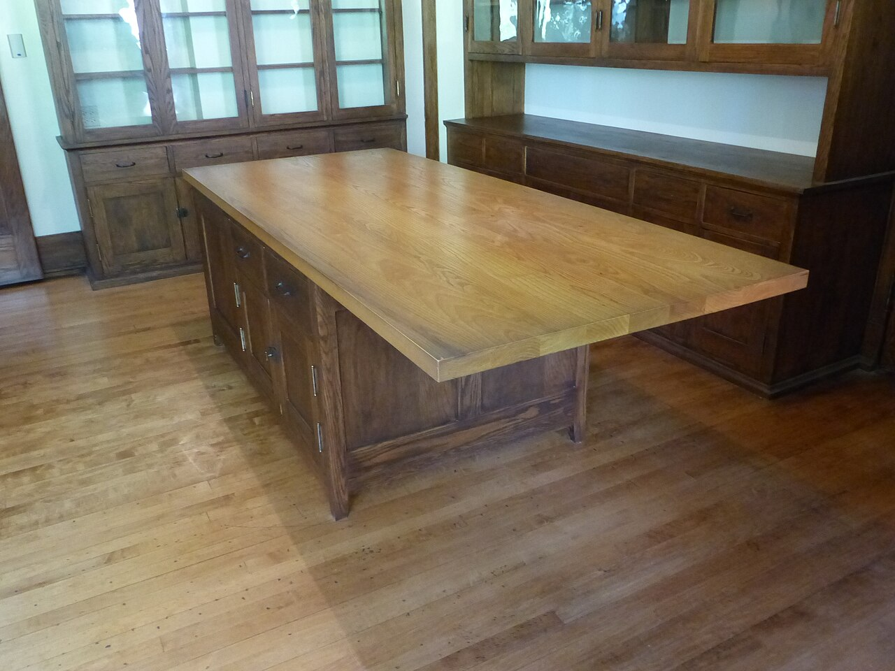
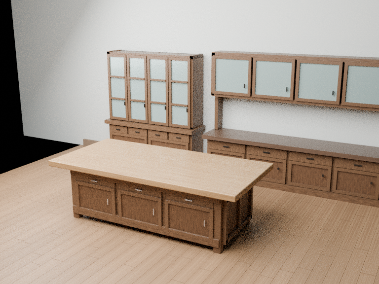
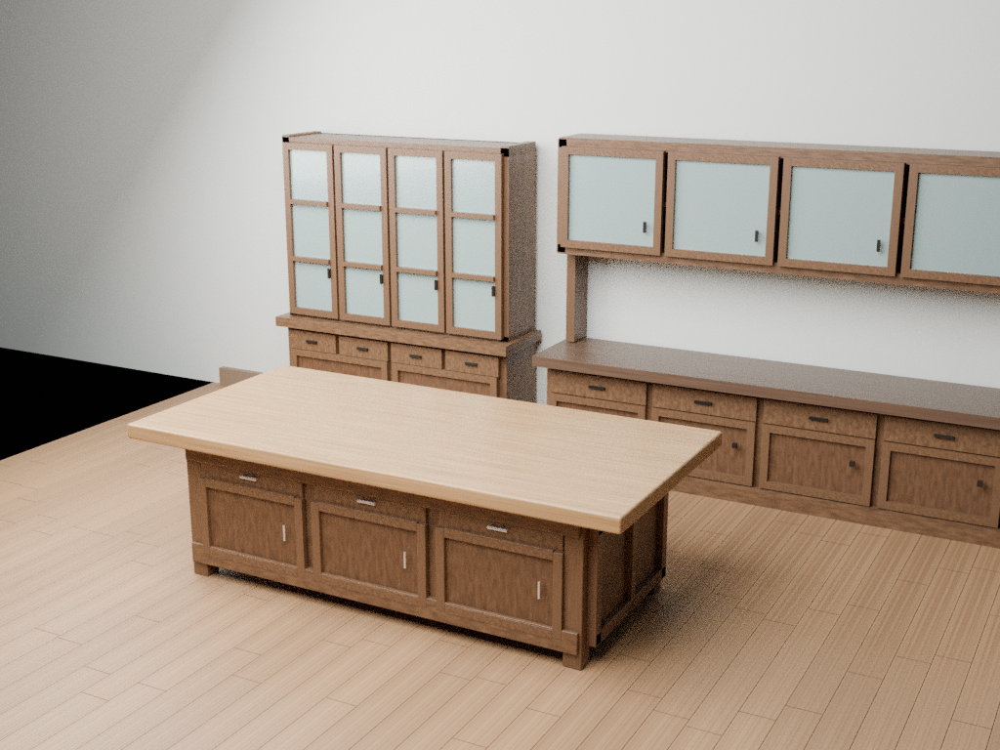

# Scene RSI 既有工程审计

本次只审计既有 Scene 实验，没有运行新 Scene RSI 或修改其学生/教师。新的文本和图像审计均通过 Codex CLI `gpt-6.1-terra / low`；历史实验原模型、推理设置和服务接入信息保留，不与本次代码终测混为同组。

## 原始目录、版本与索引

旧实验在 `/srv/lab-disks/disk2/users/xymo/rsi`，包括 phase1/2、algorithm/meta、M2/M3 等运行。较新完整原始输出在 `/srv/lab-disks/disk2/users/xymo/Documents/Codex/2026-11-02/scene-rsi-rsi-1-3d-blender/outputs`。完整旧归档位于同项目 `work/scene_archive/bundles/`，发现27个本地 tar.gz；已有展开原目录与公开副本，未重复下载或解压这些GB级资源。27个包只登记路径与大小，没有逐包内容深审，不声称验证所有归档条目。

本机公开副本 `archive/scene` 位于较新的分阶段实验分支 `d29db8ddb223dfe2899fb7a158c7fcbb1bfda690`，与实际远端该分支相同；远端默认 main 为 `355930a79d1d7ceecaddd8b549fa7a88121e97bd`。审计优先原始输出，也涵盖该新分支，而没有只看默认 main。

轻量索引遍历100,837个文件，排除缓存、环境、home和Git内部。[Scene产物索引](audit/scene_artifact_inventory.csv.gz) 按已识别文件类型列出会话、请求、程序、几何状态、渲染、H/M代码/修改、候选选择及验证。原输出和公开副本存在重复：所有计数是文件计数，不是独立尝试数；不能把2856份 session.json 当作2856次独立学生重建。

六组文本深审初始引用136个不同文件：128份完整文本、8份仅前100000字符。之后几何补审增加4份完整教师/确认/渲染设置文本，累计140份文本、其中132份完整、8份前缀；另只读载入2份既有二进制检查点。其中6份 `trajectory.jsonl` 全部是前缀审计，不能声称通读；完整阅读25份 stage_events.jsonl、21份增量 patch.py、10份 build.py 的范围不变。具体被截断范围见 [初始逐文件深审范围](audit/scene_deep_audit_sources.json)，补充来源见 [几何补审清单](audit/scene_geometry_audit_sources.json)。其余文件只做轻量索引，不能称全仓库深审完成。

另有三组原生图像输入审计（[SV01](audit/audit_SV01.md)、[SV02](audit/audit_SV02.md)、[SV03](audit/audit_SV03.md)）：共9个图像文件引用，包含6张渲染、3份参考文件；T01和E02使用同一历史厨房照片，实际只覆盖2张不同参考图。按索引的1550份 final.png 文件计，本次独立视觉审计覆盖6份，其余1544份未视觉深审，且该分母包含归档副本。图像观察不等于真实几何检测，也不是正式质量胜负评价。

## 代表案例与证据链

|案例|实际证据|能支持什么|不能支持什么|
|---|---|---|---|
|[S01：分阶段办公室D01](audit/audit_S01.md)|五阶段状态、教师 review/confirmation、实际增量补丁与渲染事件|教师确实发现遮挡、相机/黑边、偏白材质、噪声与显示器辨识问题；对应多项实际修改|教师说改好不等于图像或部件接触已验证|
|[S02：厨房T01](audit/audit_S02.md)|冻结自检规则、五阶段自评/代码、调用与渲染状态|没有在线教师仍有自检及针对性修改；真实构建多组橱柜和岛台|不能把自己声称改善或原规则被加载解释为迁移有效|
|[S03：M0/M1厨房R2](audit/audit_S03.md)|共享教师提示修改、两套指导、学生两次程序及选择记录|M1改变关系/纠错/状态记录策略，有部分指令落实|不是共同中间状态反事实；不证明M1审美质量更好|
|[S04：v3 H04](audit/audit_S04.md)|round04诊断、H.diff、接受记录及后续程序/输出|发现相机方向预测与数值投影问题，H更新直接针对它；后续代码存在投影检查|数值点投影不能替代可见轮廓、遮挡和整体质量验证|
|[S05：v3 M07](audit/audit_S05.md)|M修改、动作执行/复用合同、round07/08记录|存在真实Meta-Agent机制修改及部分执行证据|round07的M-only探索接受没有Selection结果，接受不等于能力提升|
|[S06：原pilot C1/C2](audit/audit_S06.md)|结构化诊断、几何关系、H/M补丁、学生程序和选择表|有语义对象、局部编辑/支撑/相机等机制与真实学生程序|近似包围盒、局部材质操作通过、可渲染不等于真实3D准确或纹理真实|

所有案例包含原绝对路径及一基JSONL事件号/代码行号。六份文本审计没有输入图像；其中的视觉描述是原教师或学生的判断。后续SV三组视觉审计是独立补充，不能倒写为所有原文本诊断已获图像验证。

## 既有检查点的只读几何补审

[SG01](audit/audit_SG01.md)用原Blender4.2.10分别载入D01第四阶段的 technical_repair_build 与 visual_revision_build 两份已保存scene.blend；CPU单线程、低优先级、不渲染、不保存原场景。各检查点读取874个Blender对象记录（含EMPTY等），无读取异常、无动画driver；模型解释仅使用同一computer下48个按名称/父链选出的网格及全部1128对包围盒间隔，不是48个独立语义物体或874次实验。

实际保存状态显示：Box.059等壳体材质变为 Monitor back - contrasting silver，壳体与Box.062下边框包围盒改变；Box.063支柱和Box.064–066底座包围盒未变，相机与镜头相同。角色名称来自父链与构造代码的推断。教师原要求改善朝向/对比并使支撑落桌，后续确认是 partially_resolved / advance_with_issue，接触仍未验证。包围盒变化是实际状态证据，不能把站脚没移动直接判成没有完成视觉目标。

例如下边框Box.062与支柱Box.063的包围盒距离下界由约0.0200场景单位变为0；零不证明真实表面接触，单对正间隔也不证明整个组合体断开，其他连接件可能存在。两份完整数值报告与运行资源记录在 [只读几何证据](evidence/scene_geometry/execution_records.json)；没有做精确网格碰撞、接触或真实尺度校准，也没有新增Scene学习/重建尝试。原六组文本与三组图像审计的独立性、范围限制仍保留。

## 用户关注的问题逐项核对

**多物体。** 原pilot诊断记录提到隔舱里的前景橱柜/长凳似乎缺失或被裁；未用隔离检查区分“没建”和“不可见”。C1更新针对清单、语义owner、视野和遮挡；实际学生程序确实构造多个对象。D01/T01阶段代码与事件也显示桌椅、橱柜、岛台等创建。它们支持多对象构建发生，不能证明可见对象清单完整、识别正确或物体真实重建。参见S06的 proposal `diagnosis/files`，S02阶段2/3实际 `patch.py` 与 stage_events事件5。

**材质与纹理。** 教师确实发现偏白、木纹弱、玻璃均匀、噪声等问题，并给出材质/灯光方向；实际补丁包含材质槽、程序木纹、地板和灯能量变化。但同时改材质和灯光不能唯一归因，低采样使细节判断受限。M1厨房指导要求纹理，选中的程序却没有同等木纹shader；这是部分采用，不是全部执行。S01阶段5、S02阶段3/5和S03均有具体证据。

**部件不衔接。** 原指导确实提到黑缝、框架接缝、显示器与支架接触等问题，但黑缝不直接证明真实几何断开，多个mesh也不自动是错误。D01阶段4修改了面板/边框方向及材质，没有改支架；教师最终仍无法验证接触。原pilot几何表的 true_mesh_collision_pass/true_3d_accuracy 为空，支撑/包围盒指标不能补成真实接触结论。因此只能确认存在相关问题描述和候选空间关系风险，不能宣布所有部件断开已证实或已修好。

**位置、方向、相机。** 有真实相机位置、target、lens、物体尺寸变化。M1厨房学生声称放大岛台，但前后桌面尺寸保持 `(2.18,3.42,.105)`，变化实际在相机，说明需要区分投影大小与实体尺寸并核对程序状态（S03所列两份build.py与student_decision_2）。相机调整本身可能是有效实现，不能仅因几何尺寸不变就判定图像目标失败；学生自述也可能指画面中的大小。v3 round04已指出先前相机方向预测问题并加入数值投影。分阶段D01部分相机修改改善某些构图，却引入裁切或保留黑边；T01记录还出现未获实际渲染设置支持的纵横比判断。不能将所有构图偏差归为同一个相机参数。

**光照与渲染。** 旧记录同时有成功渲染、空图/黑边、执行错误、服务路由失败和恢复。D01后期渲染记录是Cycles CPU、16 samples，不能把噪声全部归因材质。SV01独立图像审计仍看到顶部暗带与构图差异，只能提出相机/场景/渲染等候选解释。技术完成与视觉准确必须分开。

## 教师是否发现、诊断、更新、学生是否执行

不能给所有Scene实验一个统一“发现/没发现”的标签。已审案例里，教师确实发现多项用户关切，也存在针对性H/M或即时指导；部分诊断谨慎保留了相机/几何、材质/光照歧义。有些实际修改与指导一致，有些只改其中一部分，有些自述与代码不符，还有些验证仍未解决原问题。M07接受属于探索性机制准入，H04接受关联Selection增益；二者不能混为同一种经验证明。

本次有限视觉审计看到多对象的可辨识性、材质简化、构图/裁边等差异；补充的两份检查点只验证了保存几何的包围盒下界，未做精确几何连接、碰撞或真实尺度校准，不能据此判定隐藏部件或所有精确3D关系。Scene总体有效性、长期能力保持和教师自演化优势均未被本次审计证明；代码题终测也不能替代Scene独立迁移评价。

## 可复查的代表图像

SV02是同一历史厨房照片、第五阶段初始渲染与最终交付，均为未编辑的原始文件副本；它不是本次新增Scene实验，也不构成几何连接或质量因果证明。

|参考照片|第五阶段初始渲染|最终交付渲染|
|---|---|---|
|  |  |  |

SV01只对房间/相机阶段作比较，该阶段原计划不放家具；SV03是两个独立生成的M0/M1历史渲染，不是共同中间状态回放。全部原图路径与角色见 [视觉证据清单](audit/scene_visual_audit_manifest.json)。
