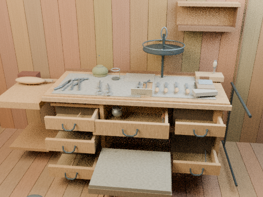
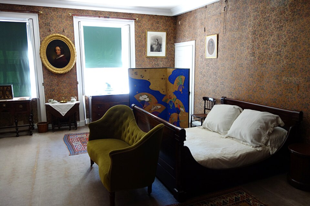
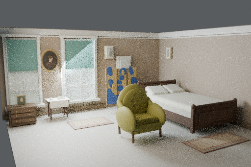
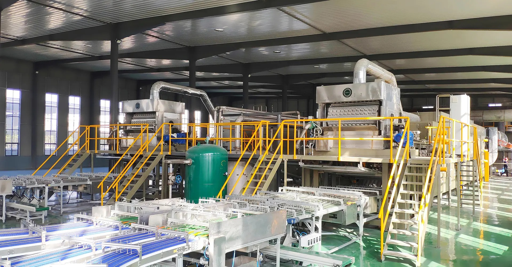
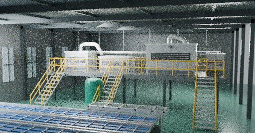
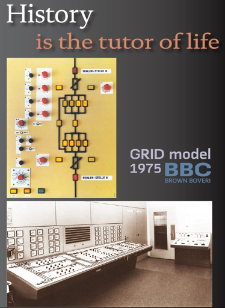
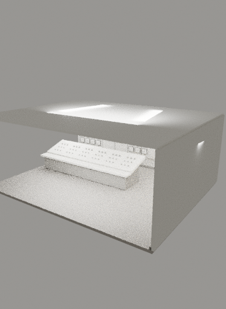

# Scene 抽样图像复查页

本页直接引用已有原图和交付渲染，没有生成或编辑图像，也没有新增质量判分。六案在视觉审阅前按固定字典序规则选取；不是随机总体样本。首图与交付图可能相同，完整覆盖说明及教师证据链见 [Scene审计](../audit_scene.md)。

## VX01 · commons_129095630

[原生CLI图像审阅](visual_VX01.md) · [原始轨迹](../../../references/Documents/Codex/2026-11-02/scene-rsi-rsi-1-3d-blender/outputs/scene_rsi_v2/results/r1/fixed_h0/H0/development/commons_129095630/trajectory.jsonl)

参考图：

交付渲染：

[首个已保存渲染](../../../references/Documents/Codex/2026-11-02/scene-rsi-rsi-1-3d-blender/outputs/scene_rsi_v2/results/r1/fixed_h0/H0/development/commons_129095630/steps/002/final.png)

## VX02 · commons_187101683

[原生CLI图像审阅](visual_VX02.md) · [原始轨迹](../../../references/Documents/Codex/2026-11-02/scene-rsi-rsi-1-3d-blender/outputs/scene_rsi_v2_1/results/r1/fixed_h0/H0/development/commons_187101683/trajectory.jsonl)

参考图：

交付渲染：

[首个已保存渲染](../../../references/Documents/Codex/2026-11-02/scene-rsi-rsi-1-3d-blender/outputs/scene_rsi_v2_1/results/r1/fixed_h0/H0/development/commons_187101683/steps/002/final.png)

## VX03 · commons_31294395

[原生CLI图像审阅](visual_VX03.md) · [原始轨迹](../../../references/Documents/Codex/2026-11-02/scene-rsi-rsi-1-3d-blender/outputs/scene_rsi_v2_2/results/r1/fixed_h/H0/fixed_version_test/commons_31294395/trajectory.jsonl)

参考图：

交付渲染：

[首个已保存渲染](../../../references/Documents/Codex/2026-11-02/scene-rsi-rsi-1-3d-blender/outputs/scene_rsi_v2_2/results/r1/fixed_h/H0/fixed_version_test/commons_31294395/steps/002/final.png)

## VX04 · commons_109923183

[原生CLI图像审阅](visual_VX04.md) · [原始轨迹](../../../references/Documents/Codex/2026-11-02/scene-rsi-rsi-1-3d-blender/outputs/scene_rsi_v3/preparation/second_smoke/historical_r1_C2_start/development/commons_109923183/1/trajectory.jsonl)

参考图：

交付渲染：

[首个已保存渲染](../../../references/Documents/Codex/2026-11-02/scene-rsi-rsi-1-3d-blender/outputs/scene_rsi_v3/preparation/second_smoke/historical_r1_C2_start/development/commons_109923183/1/steps/001/final.png)

## VX05 · bw_0017

[原生CLI图像审阅](visual_VX05.md) · [原始轨迹](../../../references/Documents/Codex/2026-11-02/scene-rsi-rsi-1-3d-blender/outputs/scene_rsi_v3/results/H01/selection/bw_0017/1/trajectory.jsonl)

参考图：

交付渲染：

[首个已保存渲染](../../../references/Documents/Codex/2026-11-02/scene-rsi-rsi-1-3d-blender/outputs/scene_rsi_v3/results/H01/selection/bw_0017/1/steps/001/final.png)

## VX06 · bw_0031

[原生CLI图像审阅](visual_VX06.md) · [原始轨迹](../../../references/Documents/Codex/2026-11-02/scene-rsi-rsi-1-3d-blender/outputs/scene_rsi_v3/results/H01/selection/bw_0031/1/trajectory.jsonl)

参考图：

交付渲染：

[首个已保存渲染](../../../references/Documents/Codex/2026-11-02/scene-rsi-rsi-1-3d-blender/outputs/scene_rsi_v3/results/H01/selection/bw_0031/1/steps/001/final.png)

